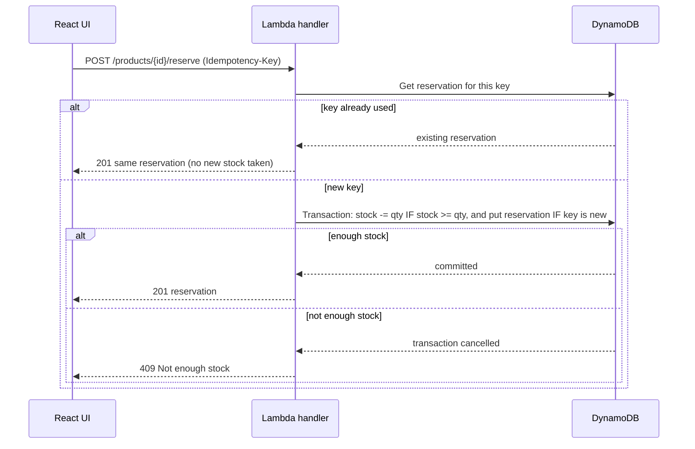

# DropStock


A full stack app for reserving limited product drops **without ever overselling**.
React frontend, Python AWS Lambda style REST API, DynamoDB.

> Built to practise the problem every limited release has: many people click Buy on
> the last few items at the same moment, and a naive read then write sells the same
> stock twice.

## Highlights

- **No oversell, even under parallel load.** One DynamoDB transaction decrements stock
  only if enough remains and creates the reservation in the same step.
- **Safe retries.** Every reservation needs an `Idempotency-Key`. Repeating a request
  with the same key returns the same reservation and never takes stock twice. Reusing a
  key for a different request is rejected with `422`.
- **Serverless design.** Four Lambda handlers behind an API Gateway HTTP API, two
  DynamoDB tables, all defined in an AWS SAM template.
- **Tested.** 22 backend tests (including 8 parallel requests racing for 3 items) and 6
  frontend tests, run by GitHub Actions on every push.
- **Runs without an AWS account.** The same handlers run locally over HTTP against an
  in-memory DynamoDB.

## How a reservation works



The stock check and the reservation write succeed or fail together, so stock can never
go below zero and a reservation can never exist without its stock being taken.

## Tech stack

| Layer | Tools |
| --- | --- |
| Frontend | React 18, Vite, Vitest, Testing Library |
| Backend | Python 3.12, AWS Lambda handlers, boto3 |
| Database | Amazon DynamoDB (two tables, on demand billing) |
| Infrastructure | AWS SAM (API Gateway HTTP API, Lambda, DynamoDB) |
| Testing | unittest, moto (in-memory AWS), Vitest |
| CI | GitHub Actions |

## Project structure

```
backend/
  app/
    handlers.py      Lambda handlers and error to HTTP status mapping
    repository.py    All DynamoDB access, including the reservation transaction
    validation.py    Request validation
    infra.py         Table definitions used by tests and local server
  tests/             22 tests: validation, endpoints, idempotency, parallel requests
  local_server.py    Runs the handlers over HTTP with in-memory DynamoDB
frontend/
  src/               React app: product list, reserve form, loading and error states
template.yaml        AWS SAM template: 4 functions, 2 tables, 1 HTTP API
.github/workflows/   CI for backend tests, frontend tests and build
```

## API

| Method | Path | Description | Responses |
| --- | --- | --- | --- |
| GET | `/products` | List products sorted by name | 200 |
| POST | `/products` | Create a product: `name`, `price_cents`, `stock` | 201, 400 |
| GET | `/products/{id}` | Get one product | 200, 404 |
| POST | `/products/{id}/reserve` | Reserve stock. Header `Idempotency-Key` required. Body: `quantity` (1 to 5), `customer` | 201, 400, 404, 409, 422 |

Example:

```bash
curl -X POST http://localhost:8000/products/<id>/reserve \
  -H "Content-Type: application/json" \
  -H "Idempotency-Key: order-1001" \
  -d '{"quantity": 2, "customer": "Asha"}'
```

Status codes: `409` means not enough stock. `422` means the same `Idempotency-Key` was
used for a different request.

## Run it locally

You need Python 3.12 (3.11 also works) and Node 20 or newer. Use two terminals.

**Terminal 1, API on http://localhost:8000**

```bash
cd backend
python -m venv venv
# Windows: venv\Scripts\activate      Mac or Linux: source venv/bin/activate
python -m pip install -r requirements-dev.txt
python local_server.py
```

**Terminal 2, UI on http://localhost:5173**

```bash
cd frontend
npm install
npm run dev
```

The local API keeps data in memory and seeds three products. Restarting it resets stock.
To point the UI at another API, set `VITE_API_URL` in `frontend/.env`.

## Run the tests

```bash
cd backend && python -m unittest discover -s . -t . -v    # 22 tests
cd frontend && npm test                                    # 6 tests
```

The backend suite uses moto, so it needs no AWS credentials. The key test sends 10
reservations for 3 items from 8 parallel workers and asserts exactly 3 succeed, 7 are
rejected and final stock is 0.

## Deploy to AWS

```bash
sam build
sam deploy --guided
```

Then set `VITE_API_URL` to the `ApiUrl` output and run `npm run build` in `frontend`.

> Status: the SAM template has not been deployed yet. All tests run against moto, not a
> real AWS account.

## Design decisions and trade-offs

- **Transaction over read then write.** A conditional update inside a transaction lets
  DynamoDB enforce the stock rule, instead of trusting application code to be fast.
- **Idempotency key in the reservation id.** The id is `productId:key`, so a duplicate key
  is rejected by a simple `attribute_not_exists` condition, with no extra lookup table.
- **Repository class.** Handlers hold no SQL or DynamoDB calls, so they stay small and
  the data layer is tested on its own.
- **One key per attempt in the UI.** A retry after a network error reuses the key, so a
  double click or a flaky connection cannot reserve twice.

## What I would improve next

- Replace the product table scan with a query pattern or a GSI for large catalogues.
- Add a TTL on reservations and a job that returns unpaid stock to the product.
- Protect the create endpoint with Cognito or a Lambda authoriser.
- Deploy with SAM and add an end to end test against the deployed API.
